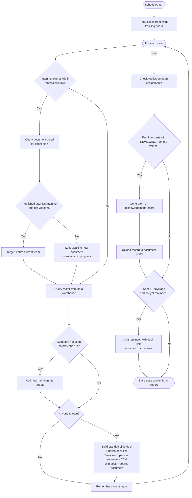
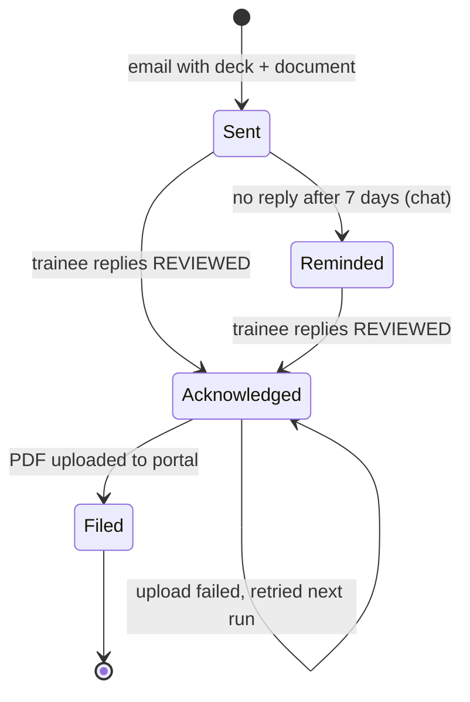
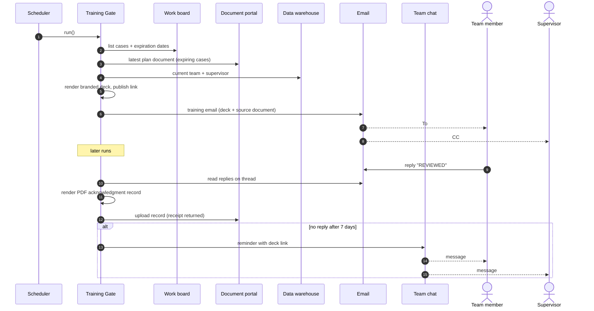
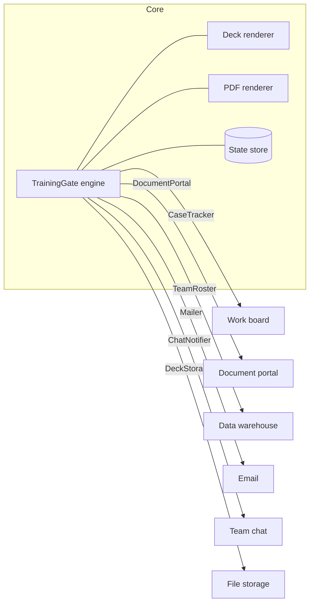

# Training Gate

**Automated, auditable compliance training for document-driven teams.**

Training Gate watches for cases whose required training is about to expire or
whose team has changed. When it finds one, it pulls the current plan document,
turns it into a branded slide deck, and emails it to the right people. It
records the email reply that confirms review, files a PDF proof of completion
back to the source portal, and sends a chat reminder when nobody responds.

> This is a public, vendor-neutral reimplementation of an automation I built
> in production. It contains **no** employer, client, customer, or personal
> data. Every name, record, and document in this repository is synthetic.
> See [Privacy and data handling](#privacy-and-data-handling).

---

## Table of contents

- [Why it exists](#why-it-exists)
- [How it works](#how-it-works)
  - [Run flowchart](#run-flowchart)
  - [Assignment lifecycle](#assignment-lifecycle)
  - [Sequence of a single training](#sequence-of-a-single-training)
- [Quick start](#quick-start)
- [Configuration](#configuration)
- [Architecture](#architecture)
  - [Project layout](#project-layout)
  - [Ports and adapters](#ports-and-adapters)
- [Connecting real systems](#connecting-real-systems)
- [Privacy and data handling](#privacy-and-data-handling)
- [Testing](#testing)
- [Roadmap](#roadmap)
- [License](#license)

---

## Why it exists

In regulated industries, every person working on a case often has to be
trained on that case's governing plan document. Two events trigger that
training:

1. **Renewal.** The training on file expires (for example, annually), and a
   new version of the plan has been published.
2. **Team change.** Someone new joins the case team mid-cycle and needs the
   current version right away.

Done by hand, this means tracking expiration dates, checking a portal for new
documents, building slides, chasing confirmations, and uploading proof. That's
slow, easy to miss, and painful in an audit. Training Gate does all of it on a
schedule and leaves a tamper-evident record for every person trained.

## How it works

Each scheduled run (daily, for example) performs three passes: **detect**,
**collect**, and **follow up**.

### Run flowchart



### Assignment lifecycle

Every person × document version becomes one **training assignment**, which
moves through these states:



### Sequence of a single training



## Quick start

Requires Python 3.11+. No third-party dependencies.

```bash
git clone https://github.com/jbisaccia-9/Training-Gate.git
cd Training-Gate
python -m training_gate demo
```

The demo plays three scheduled runs over eight days against
[synthetic data](examples/synthetic_cases.json):

```text
=== Day 0: first scheduled run ===
  [training_sent] CASE-1001 TM-A (expiring_renewal)
  [training_sent] CASE-1001 TM-B (expiring_renewal)
  [baseline_recorded] CASE-1002 1 member(s)
  [expiring_awaiting_new_document] CASE-1003 latest v2

=== Day 1 ===          (Team Member D joins; Team Member A replies "Reviewed")
  [training_sent] CASE-1002 TM-D (new_team_member)
  [acknowledged] CASE-1001 TM-A
  [filed] CASE-1001 TM-A -> portal-receipt-0001

=== Day 8 ===          (Team Member D replies; Team Member B never did)
  [acknowledged] CASE-1002 TM-D
  [filed] CASE-1002 TM-D -> portal-receipt-0002
  [reminder_sent] CASE-1001 TM-B
```

Then open `out/`:

| Output | What it is |
| --- | --- |
| `out/decks/*.html` | Branded, self-contained slide decks (arrow keys to navigate, print for PDF) |
| `out/attestations/*.pdf` | Acknowledgment records that were "uploaded" to the portal |
| `out/outbox.txt` | Every email that was sent |
| `out/chat-log.txt` | Every chat reminder |
| `out/state.json` | Durable assignment state |

To run once on a schedule (cron, a task scheduler, a CI job, or a serverless
timer):

```bash
python -m training_gate run --config config.toml
```

## Configuration

Copy [`examples/config.example.toml`](examples/config.example.toml):

```toml
[gate]
renewal_window_days = 30        # look for a new document when training expires within N days
reminder_after_days = 7         # chat reminder if no acknowledgment after N days
acknowledgement_keyword = "reviewed"
baseline_on_first_run = true    # first run records current teams without emailing everyone
state_path = ".training-gate/state.json"

[brand]                          # applied to decks and PDF records
org_name = "Example Organization"
primary_color = "#1F4E79"
accent_color = "#F2A900"
footer_text = "Internal training material. Do not forward."

[adapters]
wiring = "your_package.wiring:build_adapters"
```

Behavior worth knowing:

- **Strict acknowledgment.** Only a reply *from the trainee* whose first line
  of new text starts with the keyword counts. "Reviewed, thanks" passes.
  "Not reviewed yet", a keyword that appears only in the quoted original, and
  a reply from the supervisor all fail.
- **Idempotent.** Runs can repeat safely. Each person × document version is
  sent at most once and reminded at most once.
- **Fault-isolated.** One failing case or upload is reported as an `error`
  event and retried on the next run. It never blocks the other cases.
- **Exit code.** `run` exits `1` if any error event occurred, so a scheduler
  can alert on it.

## Architecture

### Project layout

```text
training_gate/
├── engine.py            # orchestrator: detect → dispatch → collect → file → remind
├── models.py            # Case, TeamMember, PlanDocument, TrainingAssignment, ...
├── ports.py             # interfaces the engine depends on
├── state.py             # JSON state store (swap for a DB table)
├── config.py            # TOML config + brand theme validation
├── cli.py               # `demo` and `run` commands
├── rendering/
│   ├── deck.py          # branded HTML slide deck
│   └── attestation.py   # dependency-free PDF acknowledgment record
└── adapters/
    ├── memory.py        # in-memory adapters for tests and demos
    └── fixture.py       # builds adapters from a synthetic JSON fixture
examples/
├── synthetic_cases.json # fake cases, people, and documents
├── config.example.toml
└── custom_wiring.py     # skeleton for real integrations
scripts/pii_scan.py      # blocks personal or private data from being committed
tests/                   # unit tests (stdlib unittest)
```

### Ports and adapters

The engine never imports a vendor SDK. It talks to six small protocols, so you
can swap any backing system without touching the core logic:



## Connecting real systems

Implement the ports for your stack and return them from a wiring function.
Start from [`examples/custom_wiring.py`](examples/custom_wiring.py), and read
[`docs/adapters.md`](docs/adapters.md) for the contract each adapter must meet
and for guidance on handling sensitive data in a private deployment.

## Privacy and data handling

This repository is designed to be public:

- **Synthetic data only.** All people are "Team Member A/B/C…" at
  `example.com`, cases are "Case Alpha/Bravo/Charlie", and every document
  section is placeholder text.
- **No organization specifics.** There are no real employer, customer,
  vendor, portal, or system names. Integrations are described by role
  (work board, document portal, data warehouse).
- **Automated guardrail.** [`scripts/pii_scan.py`](scripts/pii_scan.py) runs
  in CI on every push. It fails on SSN-shaped numbers, phone numbers,
  non-example email domains, and record-identifier keywords. It also fails on
  any term in a local, git-ignored `.pii-denylist` file or a `PII_DENYLIST`
  repository secret. Put real organization names there. They are checked
  but never committed or echoed in logs.
- **Runtime output is git-ignored.** `out/` and `.training-gate/` (decks,
  PDFs, state) are never committed.

```bash
echo "Some Real Company Name" >> .pii-denylist   # local only, git-ignored
python scripts/pii_scan.py
```

## Testing

```bash
python -m unittest discover -s tests -v
```

The tests cover renewal detection, first-run baselining, new-member detection,
idempotency, new document versions, strict acknowledgment parsing,
supervisor-reply rejection, PDF filing, upload-failure retry, one-time
reminders, fault isolation between cases, and state persistence.

## Roadmap

- PowerPoint (`.pptx`) deck renderer alongside HTML
- SQL-backed state store
- Configurable escalation after the reminder (e.g. a second reminder or a digest to a manager)
- Weekly compliance summary report

## License

[MIT](LICENSE)
